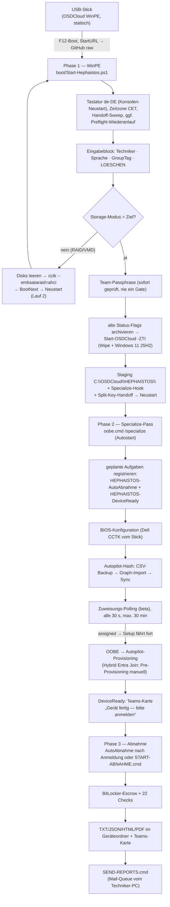

# HEPHAISTOS — Gesamtdokumentation

**SLG Notebook-Onboarding der nächsten Generation** · Version 1.3.2 · Stand: 22.10.2026

> HEPHAISTOS (der Schmiedegott, Erbauer von Automaten) schmiedet aus roher
> Dell-Hardware fertige Flottengeräte: kompletter Disk-Wipe, Neuaufbau nach
> Vorlage, Autopilot-Anbindung, automatisierte Abnahme — und sämtliche Scripts
> kommen zur Laufzeit aus diesem GitHub-Repository. Der USB-Stick ist nur noch
> der Hammer.

Dieses Dokument ist die **technische Referenz** (Architektur, Komponenten,
Status-Flags, Sicherheitsmodell, Einschränkungen). Die Schritt-für-Schritt-
Bedienung für Techniker steht in der [Techniker-Anleitung](ANLEITUNG.md), jede
Verhaltensänderung mit Begründung im [CHANGELOG](../CHANGELOG.md).

**Inhalt**

1. [Executive Summary](#1-executive-summary)
2. [Systemüberblick & Architektur](#2-systemüberblick--architektur)
3. [Einrichtung (einmalig)](#3-einrichtung-einmalig)
4. [Bedienung pro Gerät (Kurzfassung)](#4-bedienung-pro-gerät-kurzfassung)
5. [Funktionsweise im Detail](#5-funktionsweise-im-detail)
6. [Konfigurations-Referenz](#6-konfigurations-referenz)
7. [Troubleshooting & Diagnose](#7-troubleshooting--diagnose)
8. [Sicherheitskonzept](#8-sicherheitskonzept)
9. [Bekannte Einschränkungen & offene Punkte](#9-bekannte-einschränkungen--offene-punkte)
10. [Anhang](#10-anhang)

---

## 1. Executive Summary

**Ausgangslage.** Das bisherige Notebook-Onboarding (USB_ScriptTool Rev03–Rev05)
lief vollständig vom USB-Stick. Das funktionierte, hatte aber einen strukturellen
Schwachpunkt: Jeder Stick trug seine eigene Script-Kopie. Fixes und Verbesserungen
mussten auf jeden Stick einzeln verteilt werden — in der Praxis entstand
**Versions-Drift**: kein Stick war wie der andere, Fehlerbilder waren nicht
reproduzierbar, und niemand wusste sicher, welcher Stand wo lief.

**Lösung.** HEPHAISTOS dreht das Modell um: Der Stick enthält nur noch eine
statische, wartungsfreie Boot-Umgebung (OSDCloud WinPE). **Alle Logik wird zur
Laufzeit aus einem zentralen GitHub-Repository geladen** — bei jedem einzelnen
Gerätedurchlauf die jeweils aktuelle Version. Ein Bugfix wird einmal gepusht und
ist ab diesem Moment auf jedem Stick wirksam, ohne dass ein Stick angefasst wird.

**Seit v1.3.x** sind alle Techniker-Eingaben in **einen Eingabeblock am Anfang**
(WinPE) gezogen. Danach läuft das Gerät bis zum von Microsoft vorgegebenen
Pre-Provisioning-Block (Windows-Taste ×5 … Reseal) und bis zur Anmeldung für die
Abnahme ohne weitere Eingaben durch.

**Kernergebnisse:**

| Eigenschaft | Vorher (Rev05) | HEPHAISTOS 1.3.2 |
|---|---|---|
| Script-Verteilung | manuell pro Stick | zentral, ein `git push` |
| Versions-Drift | strukturell unvermeidbar | sichtbar gemacht (Versions-Banner) + eine Quelle |
| Techniker-Eingaben | über den ganzen Ablauf verteilt | ein Block in WinPE (Name, Sprache, GroupTag, `LOESCHEN`, Passphrase) |
| Storage-Modus RAID→AHCI | Risiko INACCESSIBLE_BOOT_DEVICE | Preflight **vor** der Installation, automatischer Wiederanlauf per UEFI-`BootNext` |
| Windows-Installation | manuell im Setup-Assistenten | vollautomatisch (OSDCloud ZTI, Windows 11 25H2) |
| OOBE-Schritte | Shift+F10 + Menü | Autostart im Specialize-Pass des Windows-Setups |
| Autopilot-Upload | PSGallery-Script, „warten und hoffen" | nativer Graph-REST-Import + Sync + Zuweisungs-Polling (beta) |
| Abnahme | manuell gestartet | geplante Aufgabe nach der ersten Anmeldung (manuell weiterhin möglich) |
| Abnahme-Checks | fest verdrahtet | 22 Checks, einzeln per Config schaltbar |
| Secrets | teils im Klartext im Script | AES-256-Blob auf dem Stick, Split-Key-Handoff, DPAPI-Gerätecache nur für den Webhook |
| Offline-Fähigkeit | gegeben (alles lokal) | erhalten: automatischer Fallback auf Stick- bzw. C:-Spiegel |
| Nachvollziehbarkeit | keine | Git-Historie + CHANGELOG + Release-Tags |

**Sicherheitsprinzip:** Das Repository ist öffentlich (technische Voraussetzung
für den unauthentifizierten Boot-Abruf) und deshalb per Policy **wissensfrei**:
keine Tenant-Daten, keine Secrets, keine Gerätedaten. Alles Sensible liegt
AES-256-verschlüsselt (PBKDF2-SHA256, 600 000 Iterationen) auf dem Stick und wird
nur mit der Team-Passphrase nutzbar. Details: Kapitel 8.

---

## 2. Systemüberblick & Architektur

### 2.1 Ablauf über alle Phasen



Für Textumgebungen dieselbe Kette als ASCII:

```text
Stick (WinPE) ──F12──▶ Phase 1: Eingabeblock → [RAID? Disks leeren → AHCI → BootNext → Lauf 2]
                                → Passphrase → Flags archivieren → Wipe + 25H2 → Staging + Handoff → Reboot
                        Phase 2: Specialize-Autostart → Tasks → BIOS → Hash-Import → Sync → Polling
                                 └──▶ OOBE → Autopilot-Provisioning (Hybrid Join) → DeviceReady-Karte
                        Phase 3: Anmeldung → Auto-Abnahme → Report (TXT/JSON/HTML/PDF/Teams) → Mail-Queue
```

### 2.2 Design-Prinzipien

1. **Eine Quelle der Wahrheit.** Scripts, Konfiguration und Dokumentation leben
   im Repo. Der Branch `main` ist Produktion; jeder Push wirkt beim nächsten
   Lauf flottenweit.
2. **Jeder Netz-Abruf hat einen Offline-Fallback.** Build-USB spiegelt das Repo
   nach `_HEPHAISTOS\Fallback\` auf den Stick; die Boot-Phase spiegelt zusätzlich
   nach `C:\OSDCloud\HEPHAISTOS\Fallback\`. Fällt GitHub aus, läuft der Prozess
   mit der lokalen Kopie weiter — mit gelber Warnung inkl. Stand-Datum.
3. **Versions-Banner überall.** Jedes Entry-Script meldet beim Start Version und
   Bezugsquelle (GitHub-URL oder lokale Kopie).
4. **Nie ein Gate ohne Not.** Optionale Komfortfunktionen (Passphrase-Vorabfrage,
   Handoff, Autostart, Teams-Karten, geplante Aufgaben, Autopilot-Sync) scheitern
   still bzw. gelb und fallen auf den manuellen Weg zurück, statt den Ablauf
   abzubrechen. Im Specialize-Modus endet `oobe.cmd` **immer** mit Exit-Code 0,
   weil ein RunSynchronous-Befehl mit Exit ≠ 0 das gesamte Windows-Setup abbrechen
   würde.
5. **Portiert, nicht neu erfunden.** Die Feldlogik des Rev05-Toolkits
   (Dell-WMI-Pfade, VC++-Runtime-Workaround, Event-845-Alterscheck,
   PRT-Kontext-Erkennung, State-Flag-Namen …) wurde übernommen; jede Abweichung
   ist im CHANGELOG begründet.
6. **Hybrid Entra Join bleibt.** Die Abnahme prüft AzureAdJoined **und**
   DomainJoined. Nichts im System setzt Entra-only voraus.
7. **Sichtbares Feedback.** Einheitliche Farbsprache (Grün = OK, Gelb = Hinweis,
   Rot = Fehler, Cyan = Aktion, Grau = Nebeninfo), Phasen-Kopfzeilen mit
   Zeitschätzung, `Write-Progress` bei längeren Vorgängen.

### 2.3 Komponenten

| Datei | Läuft in / als | Aufgabe |
|---|---|---|
| `boot/Start-Hephaistos.ps1` | WinPE (StartURL-Ziel) | Tastatur/Zeitzone, Eingabeblock, Storage-Preflight inkl. Wiederanlauf, Passphrase-Vorabfrage, Flag-Archiv, `Start-OSDCloud -ZTI`, Staging, Specialize-Hook, Handoff |
| `lib/Hephaistos.Common.ps1` | alle Phasen (dot-sourced) | Konsolen-Helfer, Stick-/Gerätesuche, State-System, Download mit Fallback, Secrets (v2), Split-Key-Handoff, DPAPI-Webhook-Cache, UEFI-`BootNext`, Graph-App-Token, CCTK-Paketauflösung, VC++-Workaround |
| `oobe/oobe.cmd` | Template → `C:\OSDCloud\HEPHAISTOS\oobe.cmd` und `C:\o.cmd` | Einstieg Phase 2; `/specialize` = Autostart-Modus (SYSTEM, Exit immer 0), sonst UAC-Selbst-Elevation |
| `oobe/Invoke-HephaistosOnboarding.ps1` | Specialize (SYSTEM) bzw. Shift+F10 | Orchestrator: Stick-Warteschleife, Schritt-2-Erkennung, Registrierung der geplanten Aufgaben, Schritte ausführen, Zusammenfassung |
| `oobe/steps/Invoke-BiosConfig.ps1` | Teilschritt | CCTK-Paket anwenden (vorentpackt bevorzugt, SCE-EXE als Fallback), Teilerfolgs-Auswertung, Storage-Schutz |
| `oobe/steps/Invoke-RemoveWinRE.ps1` | Teilschritt (nur `RemoveWinRE: true`) | WinRE deaktivieren, Recovery-Partition löschen, C: erweitern |
| `oobe/steps/Invoke-AutopilotHash.ps1` | Teilschritt | CSV-Export, GroupTag, DPAPI-Webhook-Cache, Registrierungs-Vorabprüfung, Graph-Import, Sync, Zuweisungs-Polling |
| `abnahme/Invoke-DeviceReady.ps1` | geplante Aufgabe `HEPHAISTOS-DeviceReady` (SYSTEM) | einmalige Teams-Karte, sobald das Gerät fertig am Anmeldebildschirm steht |
| `abnahme/Invoke-AutoAbnahme.ps1` | geplante Aufgabe `HEPHAISTOS-AutoAbnahme` (SYSTEM) | startet die Abnahme nicht-interaktiv nach der Anmeldung, entfernt sich nach Bestehen |
| `abnahme/START-ABNAHME.cmd` | Template → Stick-Root | manueller Abnahme-Start (UAC, Repo-Download, Exit-Code-Weitergabe) |
| `abnahme/Test-HephaistosDevice.ps1` | Vollwindows (Admin) | Handoff-Sweep, BitLocker-Escrow, 22 Checks, TXT/JSON, State-Flag, Report-Pipeline |
| `abnahme/report/*.ps1` | dot-sourced von der Abnahme | HTML-Report, PDF (Edge headless), Teams-Karte, App-Mailversand (reserviert) |
| `send/SEND-REPORTS.cmd` + `send/Send-QueuedReports.ps1` | Techniker-PC | Sammel-Mailversand (Graph SSO, Outlook-COM-Fallback), `.sent`-Marker |
| `config/deploy.json`, `config/report-checks.json` | Repo (zur Laufzeit geladen) | zentrale Laufzeit-Konfiguration |
| `tools/Build-USB.ps1` | Admin-PC | ADK-Prüfung, OSDCloud-Template/Workspace/WinPE, `New-OSDCloudUSB`, Stick-Sync |
| `tools/New-HephaistosSecrets.ps1` | Admin-PC | Secrets-Blob v2 erzeugen |
| `tools/secrets.template.json` | Repo | reine Schema-Referenz (Platzhalter), wird von keinem Script gelesen |

### 2.4 Ablageorte

**USB-Stick** (Datenvolume `OSDCloudUSB`, Marker-Ordner `_HEPHAISTOS`):

```text
<Stick>:\
├── _HEPHAISTOS\
│   ├── Fallback\            Repo-Spiegel (boot, lib, oobe, abnahme, send, config, docs)
│   └── Tools\               CCTK\ (+ modellspezifische CCTK-*\), Pro16Plus_CCTK_x64.exe, vc_redist.x64.exe
├── HEPHAISTOS-Secrets\
│   └── hephaistos.secrets.enc.json   (+ ggf. .v1.bak nach Migration)
├── HWID\<Serial>.csv        Autopilot-Import-CSV (Backup)
├── Logs\<Serial>\           Geräteordner: Transcripte, CCTK-Log, Reports, technician.txt, CSV-Kopie
│   └── state\               Status-Flags, preflight.resume.json, handoff.key.json, archive\
├── START-ABNAHME.cmd
└── SEND-REPORTS.cmd
```

**Gerät** (`C:\OSDCloud\HEPHAISTOS\`, entsteht beim Staging, verschwindet mit dem nächsten Wipe):

| Datei | Inhalt / Zweck |
|---|---|
| `oobe.cmd` (+ `C:\o.cmd`) | OOBE-Einstieg mit eingesetzter RawBase |
| `Fallback\` | Repo-Spiegel (Stick-Kopie, Datei für Datei frisch aus dem Repo aktualisiert) |
| `install.json` | Serial, Model, Technician, OSLanguage, GroupTagPreselect, WipeStartedUtc, StagedUtc, Version, Source |
| `technician.txt` | Technikername (Default für die Abnahme) |
| `handoff.enc.json` | Ciphertext-Hälfte des Split-Key-Handoffs (wird beim Verbrauch gelöscht) |
| `teams.webhook.bin` | DPAPI-verschlüsselte Teams-Webhook-URL (Machine-Scope) |
| `autoabnahme.log`, `deviceready.log`, `deviceready.done` | Protokolle/Done-Marker der geplanten Aufgaben |
| `Logs\<Serial>\`, `HWID\` | nur als Notbehelf, wenn kein Stick gefunden wurde |

---

## 3. Einrichtung (einmalig)

Die vollständige Einrichtung (Repo public schalten, App-Registrierung,
Secrets-Blob, Stick bauen, CCTK-Pakete, Erstverifikation, Intune-Feinschliff des
Autopilot-Profils) beschreibt die [ANLEITUNG, Kapitel 2](ANLEITUNG.md#2-einmalige-einrichtung).
Hier nur die technischen Eckpunkte.

### 3.1 Voraussetzungen

- **Admin-PC** mit Windows 11, Adminrechten, Internet und einem **Git-Clone**
  des Repos (kein ZIP — nur der Clone lässt sich per `git pull` aktuell halten).
- **Windows ADK + WinPE-Add-on** (zwei separate Installer). `Build-USB.ps1`
  prüft beides in Schritt 0 über `Installed Roots\KitsRoot10`.
- **Entra-App-Registrierung** mit Application-Permission
  `DeviceManagementServiceConfig.ReadWrite.All` (Autopilot-Import, Sync und
  Zuweisungs-Polling laufen mit demselben App-Token). `Mail.Send` (Application)
  nur für den reservierten `MailSender`-Zweig.
- **Repo public** — StartURL und alle Laufzeit-Downloads laufen
  unauthentifiziert über `raw.githubusercontent.com`.

### 3.2 Stick bauen (`tools/Build-USB.ps1`)

| Schritt | Inhalt |
|---|---|
| 0 | ADK + WinPE-Add-on vorhanden? (sonst Abbruch mit Anleitung) |
| 1 | OSD-PowerShell-Modul installieren/laden |
| 2 | `OS.OSName` gegen `Get-OSDCloudOperatingSystems` prüfen (komponentenweise: OSName-Präfix + jede Sprache + Aktivierung) |
| 3 | `New-OSDCloudTemplate -SetInputLocale de-de`, `New-OSDCloudWorkspace`, `Edit-OSDCloudWinPE -CloudDriver Dell,WiFi -StartURL <RawBase>/boot/Start-Hephaistos.ps1`, `New-OSDCloudUSB` |
| 4 | Stick-Sync: Repo-Ordner `boot, lib, oobe, abnahme, send, config, docs` → `_HEPHAISTOS\Fallback\`; `START-ABNAHME.cmd` und `SEND-REPORTS.cmd` mit eingesetzter RawBase (ASCII) in den Stick-Root; Ordner `HEPHAISTOS-Secrets`, `Logs`, `HWID`, `_HEPHAISTOS\Tools` |
| 5 | Abschluss-Checkliste (Secrets-Blob, CCTK-Pakete je `Bios.Packages`, Repo public) |

`-SkipUsbCreation` führt nur Schritt 4–5 aus (Inhalts-Sync ohne WinPE-Neubau).
Die RawBase für StartURL und Launcher kommt beim Bau aus `config/deploy.json`
und ist danach **im Stick eingebacken** (siehe 9.1).

### 3.3 Secrets-Blob und CCTK

- `tools/New-HephaistosSecrets.ps1` lädt die Lib bevorzugt aus dem lokalen
  Checkout, fragt TenantId, AppId, AppSecret (verdeckt), ReportRecipient,
  TeamsWebhookUrl (optional), MailSender (optional, reserviert) und zweimal die
  Team-Passphrase ab und schreibt einen v2-Blob (Format: 8.2) nach
  `<Stick>:\HEPHAISTOS-Secrets\hephaistos.secrets.enc.json`.
- CCTK-Pakete und `vc_redist.x64.exe` sind zu groß bzw. lizenzpflichtig fürs Repo
  und werden manuell nach `_HEPHAISTOS\Tools\` kopiert (Ordnerkonvention:
  ANLEITUNG 2.5, Paketauflösung: 5.5).

---

## 4. Bedienung pro Gerät (Kurzfassung)

Die vollständige Bedienung steht in der
[ANLEITUNG, Kapitel 3 und 4](ANLEITUNG.md#3-ablauf-pro-gerät). Aus Sicht des
Technikers:

| Phase | Was der Techniker tut | Was automatisch passiert |
|---|---|---|
| WinPE | F12 → USB; Eingabeblock: Name, Sprache, GroupTag, `LOESCHEN`, Passphrase | ggf. RAID→AHCI-Umstellung mit Wiederanlauf (15-s-Countdown, nur Passphrase neu), Wipe, Installation, Staging, Neustart |
| Specialize | nichts (Fallback ohne Autostart: Shift+F10 → `c:\o`) | BIOS, Hash-Import, Sync, Polling; Setup fährt nach der Zuweisung ohne Extra-Neustart fort |
| OOBE / Provisioning | Pre-Provisioning (Windows-Taste ×5 … Reseal) bzw. benutzergesteuerter Ablauf | Teams-Karte „Gerät fertig — bitte anmelden“ |
| Abnahme | anmelden (LAPS-Admin oder Mitarbeiter), Stick steckt | Auto-Abnahme nach `DelayMinutes`; manuell jederzeit `START-ABNAHME.cmd` |
| Versand | am eigenen PC `SEND-REPORTS.cmd` | Mail aller offenen Reports, `.sent`-Marker |

---

## 5. Funktionsweise im Detail

### 5.1 Laufzeit-Delivery & Offline-Fallback

Jedes Entry-Script trägt denselben **Lib-Bootstrap**: TLS 1.2 aktivieren →
`lib/Hephaistos.Common.ps1` von `<RawBase>/lib/…` nach `%TEMP%\HEPHAISTOS\lib\`
laden → bei Fehlschlag die erste vorhandene Fallback-Kopie mit gelber Warnung
inkl. Stand-Datum → Dot-Source. Die Bezugsquelle erscheint im Versions-Banner.
Weitere Dateien laden `Get-HephaistosScript` / `Get-HephaistosConfig` nach
demselben Muster.

| Entry-Script | Fallback-Reihenfolge |
|---|---|
| `boot/Start-Hephaistos.ps1` | `<Stick>:\_HEPHAISTOS\Fallback` |
| `oobe/Invoke-HephaistosOnboarding.ps1` | `C:\OSDCloud\HEPHAISTOS\Fallback`, dann Stick |
| `abnahme/Test-HephaistosDevice.ps1` | Stick, dann `C:\OSDCloud\HEPHAISTOS\Fallback` |
| `send/Send-QueuedReports.ps1` | eigener Spiegel-Ordner (`..\`), dann alle Sticks |
| `tools/New-HephaistosSecrets.ps1` | umgekehrt: lokaler Checkout zuerst, GitHub nur als Ersatz |

Die CMD-Launcher (`oobe.cmd`, `START-ABNAHME.cmd`, `SEND-REPORTS.cmd`) laden ihr
PowerShell-Script ebenfalls frisch aus dem Repo und fallen offline auf den
jeweiligen Spiegel zurück. Die Boot-Phase aktualisiert den C:-Spiegel nach dem
Kopieren vom Stick zusätzlich Datei für Datei aus dem Repo (best effort, nur mit
Internet) — das Gerät nimmt also die neueste Version mit in die Specialize-Phase.

### 5.2 Phase 1 — WinPE (`boot/Start-Hephaistos.ps1`)

Reihenfolge im Code:

1. **Tastatur:** In WinPE (`MiniNT`-Key) `wpeutil SetKeyboardLayout 0407:00000407`
   und einmaliger Konsolen-Neustart in einem neuen Fenster (Guard
   `HEPH_KBD_DONE`; Selbst-Kopie aus dem Repo, sonst vom Stick). Scheitert das,
   bleibt US-Layout mit gelbem Hinweis.
2. **Lib-Bootstrap**, **Zeitzone** per `tzutil /s "W. Europe Standard Time"`
   (OSDCloud-WinPE startet auf Pacific Time).
3. **Gerät + Stick:** Service Tag/Modell per WMI (Fallback: manuelle Eingabe,
   markiert als `ManualSerial`), Geräteordner `Logs\<Serial>\state` (ohne Stick
   nach Rückfrage auf C: bzw. RAM-Disk — überlebt den Wipe nicht).
   `Clear-HephHandoffKeys` entwertet alte Handoff-Schlüssel (eigene Serial immer,
   fremde nach 24 h). Transcript `WinPE_<Zeit>.log`.
4. **Config:** `deploy.json` laden; ab hier gilt `Repo.RawBase` aus der Config
   für Spiegel-Refresh und `{{RAWBASE}}`-Ersetzung.
5. **Preflight-Wiederanlauf** (nur wenn `state\preflight.resume.json` existiert):
   Die Datei wird beim Lesen **sofort gelöscht** (One-Shot). Akzeptiert wird sie
   nur, wenn die Serial nicht manuell eingegeben wurde, Serial (case-sensitiv)
   und Modell live passen, ihre Nonce im Flag `storage_mode.attempted` steht
   und **alle internen Disks** (NVMe/SATA/SAS/RAID/ATA, > 60 GB) keine Partition haben. Dann
   Zusammenfassung + 15-s-Countdown (`Wait-HephResumeCountdown`, fail-closed:
   Tastendruck oder Exception = interaktiv).
6. **OS-Soft-Check** gegen `Get-OSDCloudOperatingSystems` (Rückfrage bei
   Abweichung; im Wiederanlauf übernommen).
7. **Eingabeblock:** Technikername (Default aus `technician.txt` früherer
   Läufe), Sprache aus `Languages`, GroupTag-Vorauswahl aus
   `Languages.<n>.GroupTag`, roter Warnblock mit `LOESCHEN` — im Wiederanlauf
   alles aus Lauf 1.
8. **Storage-Modus-Preflight** (`Bios.StorageMode`, Default `Ahci`; `Keep`/`None`
   = aus): `cctk.exe` aus dem modellspezifischen Paketordner (x64 bevorzugt) fragt
   `--embsataraid` ab.
   - nicht abfragbar / kein cctk → übersprungen (Dim-Hinweis);
   - **passt** → `storage_mode.attempted` und `storage_mode.keep` werden entfernt
     (v1.3.2: ein Merker aus einem früheren Lauf darf nach BIOS-Reset/Board-Tausch
     weder die Automatik blockieren noch das CCTK-Paket sperren);
   - **weicht ab** (erster Versuch, Stick vorhanden) → Flag
     `storage_mode.attempted` mit Zufalls-Nonce, alle internen Disks per
     `Clear-Disk -RemoveData -RemoveOEM` leeren, `cctk --embsataraid=<ziel>`;
     Erfolg nur bei Exit-Code 0. Dann `Set-HephBootNextToCurrent` (UEFI
     `BootCurrent` → `BootNext`, einmalig, Boot-Reihenfolge bleibt), Schreiben von
     `preflight.resume.json` **nur in diesem Erfolgszweig** und Neustart;
   - **weicht ab** und Flag existiert schon / kein Stick / Umstellung gescheitert →
     interaktive Entscheidung: unter dem aktuellen Modus installieren (setzt
     `storage_mode.keep`) oder Abbruch mit `BootNext` + Neustart.
9. **Team-Passphrase** (`Oobe.PassphraseUpfront`, Default an; nur wenn ein Blob
   auf dem Stick liegt): `Get-HephaistosSecrets` mit max. 3 Versuchen, in
   `try/catch` — Fehlschlag ist **nie** ein Abbruch, die Specialize-Phase fragt
   dann selbst. Es wird hier noch nichts geschrieben. Im RAID-Fall kommt diese
   Abfrage erst in Lauf 2.
10. **Flag-Archiv (v1.3.2):** Status-Flags einer früheren Installation
    (`step1_bios.done`, `step2_osinstall.started`, `step2_osinstall.done`,
    `step3_hash.done`, `step4_compliance.done`, `storage_mode.attempted`) werden
    nach `state\archive\<yyyyMMdd-HHmmss>\` verschoben (Fallback: löschen).
    `storage_mode.keep` bleibt, weil es in **diesem** Lauf gesetzt worden sein
    kann und in der OOBE gebraucht wird.
11. **Installation:** `step2_osinstall.started` setzen, unmittelbar danach
    `Start-OSDCloud -OSName … -OSEdition … -OSActivation … -OSLanguage … -ZTI`.
12. **Staging** nach `C:\OSDCloud\HEPHAISTOS\` (Inhalt: 2.4), inklusive
    **Specialize-Hook** (`Oobe.AutoLaunch`): echter XML-Merge in das von OSDCloud
    gestagte `C:\Windows\Panther\Unattend.xml` — `RunSynchronousCommand` im
    Pass `specialize`, Komponente `Microsoft-Windows-Deployment`, Pfad
    `cmd.exe /c C:\OSDCloud\HEPHAISTOS\oobe.cmd /specialize`, nächste freie
    `Order`, idempotent (kein Doppel-Eintrag). Danach **Split-Key-Handoff**
    (8.3), außer bei manuell eingegebener Serial.
13. **Neustart** nach 10-s-Countdown (`wpeutil reboot`).

### 5.3 State-System

Pro Gerät führt der Stick `Logs\<Serial>\state\`. Flag-Dateien enthalten eine
Zeile `yyyy-MM-dd HH:mm  <Detail>` (`Set-Step`); Existenzprüfung per `Test-Step`,
Pfad per `Get-StepFlag`. Die Namen `step1…step4` stammen aus dem Alt-Toolkit und
bilden nicht die heutige Reihenfolge ab (Report/Zusammenfassung zeigen:
Installation, BIOS, Hash, Abnahme).

| Flag | geschrieben von | gelesen / entfernt von | Bedeutung |
|---|---|---|---|
| `storage_mode.attempted` | Boot, Preflight-Umstellzyklus (mit `Nonce=`) | Boot: Loop-Schutz (2. Versuch → interaktiv), Nonce-Prüfung des Wiederanlaufs; **entfernt**, wenn der Modus passt; **archiviert** beim Wipe-Start | automatische Umstellung wurde bereits versucht |
| `storage_mode.keep` | Boot, wenn bewusst unter abweichendem Modus installiert wird | OOBE-BIOS-Schritt: CCTK nur nach roter Rückfrage; Boot **entfernt** es, wenn der Modus passt | Storage-Modus nach der Installation nicht mehr anfassen |
| `step2_osinstall.started` | Boot, unmittelbar vor `Start-OSDCloud` | OOBE: Zeitstempel-Fallback der Schritt-2-Erkennung; **archiviert** beim nächsten Wipe-Start | Wipe von diesem Stick initiiert |
| `step2_osinstall.done` | OOBE-Orchestrator (automatisch) | OOBE-Zusammenfassung, HTML-Report; **archiviert** | Neuinstallation nachgewiesen |
| `step1_bios.done` | BIOS-Schritt bei RC 0 oder Teilerfolg ohne Passwortfehler | Zusammenfassung, HTML-Report; **archiviert** | CCTK angewendet (Detail nennt RC und ggf. nicht anwendbare Optionen) |
| `step3_hash.done` | Hash-Schritt (auch bei reinem CSV-Backup) | Zusammenfassung, HTML-Report; **archiviert** | Hash gesichert; Detail nennt Variante (Online-Upload, bereits registriert, Offline-CSV …) und GroupTag |
| `step4_compliance.done` | Abnahme bei SUCCESS / SUCCESS_WITH_WARNINGS | Auto-Abnahme (bestanden → Aufgabe entfernt sich), Report; Abnahme **löscht** es bei FAILED (v1.3.2); **archiviert** | Abnahme bestanden |

Weitere Dateien im State-Ordner, die keine Flags sind:

| Datei | Lebensdauer |
|---|---|
| `preflight.resume.json` | einmalige Wiederanlauf-Zustimmung (Nonce, Serial, Model, Technician, LanguageKey, GroupTag, CreatedUtc); wird beim Lesen gelöscht |
| `handoff.key.json` | Schlüssel-Hälfte des Handoffs; gelöscht beim Verbrauch, beim WinPE-Start (eigene Serial) bzw. nach 24 h, und in der Abnahme |
| `archive\<Zeitstempel>\` | archivierte Flags früherer Installationen (bleiben zur Nachvollziehbarkeit liegen) |

**Schritt-2-Erkennung** (OOBE): Primärer, uhr-freier Nachweis ist
`C:\OSDCloud\HEPHAISTOS\install.json` mit passender Seriennummer — die Datei
schreibt nur das Boot-Script nach `Start-OSDCloud`, ein Werks-OS kann sie nicht
besitzen. Fallback: OS-`InstallDate` (Registry, Unix-Epoch) liegt nach dem
Zeitstempel von `step2_osinstall.started` minus 26 h Toleranz (WinPE-/FAT-
Zeitzonenversatz). Ohne Nachweis gibt es nur gelbe Prüfdetails, keinen Dialog.

### 5.4 Phase 2 — Specialize / OOBE (`oobe/Invoke-HephaistosOnboarding.ps1`)

- **Modus:** `oobe.cmd /specialize` setzt `HEPH_SPECIALIZE=1` (läuft als SYSTEM
  aus dem Windows-Setup, keine Elevation). Ohne Argument fordert `oobe.cmd` per
  `fltmc`-Probe + UAC Adminrechte an (Nachläufe im fertigen Windows).
- **Stick-Warteschleife:** bis zu 90 s, Suche alle 3 s (USB-Stack ist im
  Specialize-Pass oft noch nicht bereit). Danach Ohne-Stick-Pfad.
- **Tastatur** per `Set-WinUserLanguageList` auf die Installationssprache aus
  `install.json` (best effort).
- **Specialize-Automatik:** Technikername und GroupTag werden aus `install.json`
  ohne Rückfrage übernommen; die Zugänge kommen aus dem Handoff (8.3).
- **Geplante Aufgaben** werden **vor** den Schritten registriert (5.7).
- **Schritte:** BIOS → (optional) RemoveWinRE → Autopilot-Hash; jedes Script
  frisch aus dem Repo (Fallback: Spiegel), Aufruf mit einem `-Context`-Hashtable
  (UsbRoot, DevDir, StateDir, Serial, Model, GroupTagPreselect, SpecializeMode,
  Config, RawBase, FallbackRoots, Technician, SecretsPath). Ein Fehler führt zur
  Rückfrage „Trotzdem fortfahren?“.
- **Zusammenfassung** der vier Flags, außer der Hash-Schritt hat einen
  Neustart eingeleitet (`$Context['AutoReboot']`).

### 5.5 BIOS-Schritt (`oobe/steps/Invoke-BiosConfig.ps1`)

- **Paketauflösung** (`Get-HephBiosPackageDir`): `Bios.Packages` mappt
  Modell-Teilstrings auf Ordner unter `_HEPHAISTOS\Tools\`; der **längste**
  Treffer gewinnt; fehlt der Ordner, gilt `Bios.DefaultPackage` (`CCTK`).
- **Storage-Schutz:** existiert `storage_mode.keep`, wird das Paket nur nach
  roter Rückfrage angewendet (eine EmbSataRaid-Option im Paket würde das frische
  Windows unbootbar machen).
- **Kette:** vorentpacktes `applyconfig.bat` (Log `cctk_apply.log` im
  Geräteordner) bevorzugt; sonst `Pro16Plus_CCTK_x64.exe` (SCE) mit
  `Install-VcRuntimeIfMissing` (Exit 0/3010/1638 = ok).
- **Bewertung:** RC 0 = grün. Bei RC ≠ 0 wird das Log nach
  `error setting the option '…'` durchsucht: nur nicht anwendbare Optionen →
  gelb, Flag wird gesetzt; scheitert ein Passwort selbst (`SetupPwd`, `SysPwd`,
  `OwnPwd`, `AdminPwd`, jeweils auch mit `Val`-Präfix) oder ist das Fehlerbild
  unbekannt → rot, kein Flag. Passwort-nahe Optionen ergeben gelb mit
  Sicherheitshinweis. Die Abnahme prüft das BIOS-Admin-Passwort unabhängig davon.
- Kein Neustart in diesem Schritt.

### 5.6 Autopilot-Hash (`oobe/steps/Invoke-AutopilotHash.ps1`)

1. **Offline-Export immer zuerst:** Hash aus `MDM_DevDetail_Ext01`
   (`root/cimv2/mdm/dmmap`), CSV im Intune-Importformat nach
   `<Stick>:\HWID\<Serial>.csv` (ohne Stick: `C:\OSDCloud\HEPHAISTOS\HWID`),
   Kopie im Geräteordner. Die Spalte „Windows Product ID“ bleibt leer (v1.3.2).
2. **GroupTag:** im Specialize-Modus automatisch aus der WinPE-Vorauswahl, sonst
   Auswahl mit Enter-Default; wird in die CSV eingetragen.
3. **Ohne Netz** (`graph.microsoft.com:443`) → `step3_hash.done` „Offline-CSV“.
4. **Zugänge:** `Get-HephaistosSecrets` (im Specialize-/OOBE-Kontext zuerst
   Handoff, sonst Passphrase). Bei Erfolg wird die Teams-Webhook-URL zusätzlich
   in den DPAPI-Gerätecache geschrieben (8.4). Ohne Zugänge: Rückfrage, ob der
   interaktive PSGallery-Weg (`Get-WindowsAutopilotInfo -Online`) versucht
   werden soll; sonst CSV-Backup als Ergebnis.
5. **Vorabprüfung** (beta `windowsAutopilotDeviceIdentities`,
   `contains(serialNumber,…)`): nur ein **exakter** Serial-Treffer gilt als
   „bereits registriert“ → Upload entfällt, GroupTag-Abweichung oder fehlendes
   GroupTag wird gemeldet.
6. **Import** per App-Token: `POST beta/deviceManagement/importedWindowsAutopilotDeviceIdentities`
   (serialNumber, groupTag, hardwareIdentifier = Base64 aus WMI). Status-Polling
   alle 15 s, max. 80× (20 min), eine 401-Token-Erneuerung. `complete` = Erfolg;
   `deviceErrorCode 806` / `ZtdDeviceAlreadyAssigned` = bereits registriert;
   bei Fehlern wird `error.message` aus dem OData-Body angezeigt.
7. **Sync (v1.3.2):** nach `complete` best effort
   `POST beta/deviceManagement/windowsAutopilotSettings/sync` (rate-limitiert;
   ein Fehler ändert nichts am Ergebnis).
8. **Zuweisungs-Polling:** beta-Endpunkt (nur dort gibt es
   `deploymentProfileAssignmentStatus`), alle 30 s, max. 60× (30 min),
   `Write-Progress`, eine 401-Erneuerung. Gewertet wird **nur der Eintrag mit
   exakt dieser Seriennummer** (v1.3.2: kein Rückfall auf den ersten
   `contains()`-Treffer mehr). Bei `assigned*`:
   - Specialize-Modus: kein Neustart — das Setup fährt fort und die OOBE startet
     direkt im zugewiesenen Profil;
   - manueller Modus: `shutdown /r /t 10` mit Countdown.

   Timeout → gelber Hinweis auf die GroupTag-Gruppe, kein Neustart. Nach dem
   interaktiven Upload gibt es kein App-Token und damit kein Polling.

### 5.7 Geplante Aufgaben

Beide Aufgaben laufen als **SYSTEM** (`RunLevel Highest`), sind mit
`-AllowStartIfOnBatteries -DontStopIfGoingOnBatteries` registriert (sonst
startet der Task Scheduler auf Notebooks im Akkubetrieb nicht), starten ihr
Script aus `C:\OSDCloud\HEPHAISTOS\Fallback\abnahme\`, haben **keine
Lib-Abhängigkeit** und entfernen sich nach getaner Arbeit selbst.

| | `HEPHAISTOS-DeviceReady` | `HEPHAISTOS-AutoAbnahme` |
|---|---|---|
| Schalter | `Abnahme.ReadyMessage` (fehlend = an, nur explizit `false` = aus) | `Abnahme.AutoRun` (nur explizit `true` = an) |
| Trigger | beim Systemstart, 3 min verzögert | bei Anmeldung, `Abnahme.DelayMinutes` verzögert (Default 5) |
| Script | `Invoke-DeviceReady.ps1` | `Invoke-AutoAbnahme.ps1` |
| Bedingungen | kein regulärer Benutzer angemeldet und noch kein echtes Profil (`defaultuser\d+`, `WDAGUtilityAccount` und Spezialprofile zählen nicht); Intune-Enrollment (`ProviderID = MS DM Server`) + IME-Dienst; nach 60 s Kontrollpause weiterhin niemand angemeldet | regulärer Benutzer angemeldet (kein `defaultuser0`), IME-Dienst vorhanden, Stick eingesteckt |
| Aktion | Teams-Karte „GERÄT FERTIG EINGERICHTET“ (Hostname, Modell, Service Tag, LAPS-Hinweis, Link auf die Intune-Geräteliste) über den DPAPI-Cache; 3 Versuche im Abstand von 60 s | `Test-HephaistosDevice.ps1 -NonInteractive` in einem Kindprozess (Repo, Fallback Stick/C:), Timeout 90 min |
| Ende | Done-Marker `deviceready.done` + Selbst-Entfernung bei Erfolg, bei „Benutzer war schneller“ und bei fehlendem Cache; bei 3 Fehlversuchen nächster Systemstart | Selbst-Entfernung, sobald `step4_compliance.done` auf dem Stick existiert (ersatzweise Exit 0, wenn kein Flag-Pfad bestimmbar ist); sonst nächste Anmeldung |
| Protokoll | `C:\OSDCloud\HEPHAISTOS\deviceready.log` | `C:\OSDCloud\HEPHAISTOS\autoabnahme.log` |

Die Device-Ready-Karte nutzt dasselbe AdaptiveCard-Format wie die Abnahme-Karte,
aber ohne `slg`-Feld (kein PDF) — der bestehende Power-Automate-Flow braucht
keine Änderung. Da beim Wipe-Start alte Flags archiviert und bei FAILED ein
vorhandenes `step4_compliance.done` gelöscht wird, kann die Auto-Abnahme ein neu
aufgesetztes Gerät nicht mehr wegen eines alten „bestanden“ überspringen (v1.3.2).

### 5.8 Abnahme und Check-Engine (`abnahme/Test-HephaistosDevice.ps1`)

- **Rahmen:** Adminrechte Pflicht; unter `defaultuser0` (OOBE) Abbruch. Mit
  `-NonInteractive` keinerlei Prompts (Techniker aus `technician.txt`, sonst
  „Automatisch (Auto-Abnahme)“; Secrets übersprungen; unlesbarer Service Tag =
  Abbruch). Weitere Parameter: `-SkipWindowsUpdateScan`, `-MinBuild`, `-NoReport`.
- **Aufräumen:** liegengebliebene Handoff-Dateien (C: und Stick, inkl. `.tmp`)
  werden geschreddert. Transcript `Abnahme_<Zeit>.log`.
- **BitLocker-Escrow vor den Checks:** fehlender RecoveryPassword-Protector wird
  angelegt, alle Protectoren per `BackupToAAD-BitLockerKeyProtector` gesichert.
- **Config-Gate** (`Invoke-Check -Id`): fehlt die ID in `report-checks.json` →
  aktiv; `false` → Testblock wird **nicht** ausgeführt, Ergebnis **SKIPPED**
  („per Config deaktiviert“), zählt weder in Summary noch Exit-Code.
- **Schweregrade:** Pflicht-Checks → FAILED; mit `-Warning` markierte Checks →
  WARN. Gesamtergebnis **SUCCESS / SUCCESS_WITH_WARNINGS / FAILED**; Exit-Code 0
  ohne FAILED, sonst 1. Dazu INFO-Zeilen (BIOS-Version, OS-Installationsdatum,
  nicht bewertbarer PRT-Kontext).
- **Sonderfall lokale Admin-Session** (`Test-HephLocalAdminSession`,
  Konsolen-User = `<HOSTNAME>\<LocalAdminAccount>`): `entra-prt` → SKIPPED
  (lokales Konto hat keinen PRT), `netskope-tunnel` → nur Dienst `stAgentSvc`
  (Running + Automatic). Läuft das Script unter einem anderen Konto als dem
  Konsolen-User, wird `entra-prt` zu INFO.
- **Ausgaben:** Konsole (farbig), `<Hostname>_<Zeit>.txt` und `.json`
  (Schema 2: Summary.Status/Passed/Warned/Failed/Total, Results) im Geräteordner;
  danach Setzen bzw. Löschen von `step4_compliance.done` (5.3).

### 5.9 Report-Pipeline

1. **HTML-Report** (`New-HephaistosHtmlReport`, immer — auch bei FAILED):
   `Onboarding-Report_<Hostname>_<Zeit>.html` im Geräteordner, mit
   Onboarding-Schritten aus den State-Flags, allen Checks und dreistufigem Badge.
2. **PDF** via Edge headless (`Convert-HtmlToPdf`, best effort; Argumente mit
   Leerzeichen werden komplett gequotet, da PS 5.1 `Start-Process` das nicht
   selbst tut).
3. **Teams-Karte** (`Send-TeamsCard`, AdaptiveCard 1.4 über den
   Workflows-Webhook): Ampelfarbe, Gerät, Service Tag, Hostname, primärer
   Benutzer, Techniker. Mit `Report.TeamsAttachPdf` zusätzlich das Feld `slg`
   (Dateiname, Base64, Status, Serial) und ein „Report (PDF) öffnen“-Button mit
   `{{FILEURL}}`, den der Power-Automate-Flow ersetzt. **Webhook-Quelle:**
   entsperrter Secrets-Blob (interaktiver Lauf) **oder** DPAPI-Gerätecache —
   so postet auch die Auto-Abnahme ohne Passphrase.
4. **Mail:** am Kundengerät keine Anmeldung. Nur wenn der entsperrte Blob einen
   `MailSender` enthält, bietet die Abnahme den App-Versand
   (`users/<MailSender>/sendMail`) an — reservierter Zweig. Standard ist
   `SEND-REPORTS.cmd` am Techniker-PC: sammelt `Onboarding-Report_*` ohne
   `.sent`-Marker (PDF vor HTML), Empfänger aus dem Blob (Passphrase),
   Versand bevorzugt delegiert über Graph `/me/sendMail`
   (`Microsoft.Graph.Authentication`, Scope `Mail.Send`), nach dem ersten
   Graph-Fehler für den Rest des Laufs per Outlook-COM; danach `<Report>.sent`.

### 5.10 Versionierung & Rollback

Eine zentrale Versionskonstante in der Lib (`$HephaistosVersion`) speist Banner,
Report-Kopf und -Fuß; die Entry-Scripts tragen ihre Version zusätzlich im
Bootstrap (`$Script:HephVersion`). Änderungen laufen über `main` (= Produktion).
Release-Tags (z. B. `v1.0.2`) dienen als Referenzstände. Ein **Rollback**
erfolgt am zuverlässigsten per `git revert` auf `main`: Die Bootstrap-Konstanten, der Auto-Abnahme-Wächter und die beim Stick-Bau
eingebackene StartURL zeigen fest auf `main`; ein auf einen Tag gestelltes
`Repo.RawBase` in `deploy.json` wirkt deshalb nur auf die Teile, die die
Config-RawBase verwenden (siehe 9.1).

---

## 6. Konfigurations-Referenz

Die feldgenaue Beschreibung beider Dateien steht in der
[ANLEITUNG, Kapitel 5](ANLEITUNG.md#5-konfiguration). Ergänzend hier, **welche
Komponente welchen Schlüssel liest**:

### 6.1 `config/deploy.json` (ConfigVersion 2.0.0)

| Schlüssel | gelesen von | Hinweis |
|---|---|---|
| `OS.OSName`, `OS.OSEdition`, `OS.OSActivation` | Boot (`Start-OSDCloud`, Soft-Check), Build-USB (Katalog-Check) | OSName bewusst in Kurzform (`Windows 11 25H2 x64`) |
| `Languages.<n>.Label/OSLanguage/GroupTag`, `DefaultLanguageKey` | Boot | GroupTag = Vorauswahl je Sprache |
| `Bios.StorageMode` | Boot (Preflight) | Default `Ahci`; `Keep`/`None` = aus |
| `Bios.DefaultPackage`, `Bios.Packages` | Boot (cctk für den Preflight), BIOS-Schritt, Build-USB (Checkliste) | längster Modell-Teilstring gewinnt |
| `MinBuild` | Abnahme (`windows-min-build`) | Notfall-Default 26200, Parameter `-MinBuild` übersteuert |
| `RemoveWinRE` | OOBE-Orchestrator + Schritt selbst (Doppelboden) | Default `false` |
| `GroupTags` | Boot (Auswahl), Hash-Schritt (Auswahl/Validierung) | Fallback-Liste im Hash-Schritt, falls leer |
| `Oobe.AutoLaunch` | Boot (Specialize-Hook) | nur explizit `true` = an |
| `Oobe.PassphraseUpfront` | Boot | fehlend = an |
| `Abnahme.AutoRun`, `Abnahme.DelayMinutes` | OOBE-Orchestrator (Registrierung) | AutoRun nur explizit `true` = an |
| `Abnahme.ReadyMessage` | OOBE-Orchestrator (Registrierung) | fehlend = an |
| `Report.TeamsAttachPdf` | Abnahme (Teams-Karte) | Default `true` |
| `Repo.RawBase` | Build-USB (StartURL, Launcher), Boot (Spiegel-Refresh, `oobe.cmd`-Template) | siehe 5.10 / 9.1 |

### 6.2 `config/report-checks.json`

```json
{
  "LocalAdminAccount": "intuneadm",
  "Checks": { "<check-id>": true | false }
}
```

Fehlender Key = Check aktiv. `false` = SKIPPED (sichtbar, zählt nicht).
`LocalAdminAccount` steuert die Sonderfälle von `entra-prt` und `netskope-tunnel`.

### 6.3 Die 22 Abnahme-Checks

| # | Check-ID | Prüfung | Art |
|---|---|---|---|
| 1 | `hostname-convention` | Hostname beginnt mit `SLG(DE\|FR\|PL\|TEST)-` | Pflicht |
| 2 | `hybrid-join-azuread` | dsregcmd: AzureAdJoined = YES | Pflicht |
| 3 | `hybrid-join-domain` | dsregcmd: DomainJoined = YES | Pflicht |
| 4 | `entra-prt` | AzureAdPrt = YES (INFO bei fremdem Kontext, SKIPPED in lokaler Admin-Session) | Pflicht |
| 5 | `tpm-20` | TPM vorhanden, bereit, SpecVersion 2.0 | Pflicht |
| 6 | `secure-boot` | Secure Boot aktiv (UEFI) | Pflicht |
| 7 | `bios-admin-password` | Dell-BIOS-Admin-Passwort gesetzt (`root\dcim\sysman\wmisecurity`) | Pflicht |
| 8 | `bitlocker-protection` | BitLocker auf C: an, FullyEncrypted oder EncryptionInProgress | Pflicht |
| 9 | `bitlocker-recovery-protector` | RecoveryPassword-Protector vorhanden | Pflicht |
| 10 | `bitlocker-escrow-845` | Event 845 vorhanden und nicht älter als die OS-Installation (Event 846 wird als Hinweis genannt) | Pflicht |
| 11 | `service-netskope` | Dienst `stAgentSvc` läuft + Autostart | Pflicht |
| 12 | `service-sentinelone` | Dienst `SentinelAgent` läuft + Autostart | Pflicht |
| 13 | `service-intune-ime` | `IntuneManagementExtension` läuft + Autostart | Pflicht |
| 14 | `netskope-tunnel` | `nsdiag -f` meldet `NSTUNNEL_CONNECTED` (lokale Admin-Session: nur Dienst) | Pflicht |
| 15 | `av-roles` | SentinelOne aktiv **und** Defender-Echtzeitschutz aus/passiv | Pflicht |
| 16 | `company-portal` | Appx `Microsoft.CompanyPortal` installiert | Pflicht |
| 17 | `windows-min-build` | Build ≥ MinBuild | Pflicht |
| 18 | `windows-activation` | Windows aktiviert (LicenseStatus = 1) | Pflicht |
| 19 | `pending-reboot` | kein Neustart ausstehend (CBS/WU) | Hinweis |
| 20 | `driver-errors` | keine PnP-Geräte mit Fehlerstatus | Hinweis |
| 21 | `timezone-country` | Zeitzone passt zum Ländercode im Hostname | Hinweis |
| 22 | `windows-update-scan` | keine ausstehenden Software-Updates (Scan 1–3 min; per Parameter überspringbar) | Hinweis |

---

## 7. Troubleshooting & Diagnose

Symptom → Ursache → Lösung für den Techniker steht in der
[ANLEITUNG, Kapitel 6](ANLEITUNG.md#6-troubleshooting). Für die technische
Analyse sind diese Quellen maßgeblich:

| Quelle | Ort | Inhalt |
|---|---|---|
| WinPE-Transcript | `<Stick>:\Logs\<Serial>\WinPE_<Zeit>.log` | Eingabeblock, Preflight (inkl. cctk-Ausgabe), Flag-Archiv, OSDCloud, Staging, Handoff |
| OOBE-Transcript | `<Stick>:\Logs\<Serial>\OOBE_<Zeit>.log` | Stick-Wartezeit, Schritt-2-Nachweis, Task-Registrierung, BIOS, Import/Sync/Polling |
| CCTK-Log | `<Stick>:\Logs\<Serial>\cctk_apply.log` (bzw. kopierte SCE-Logs) | nicht anwendbare Optionen, Passwort-Fehler |
| Abnahme | `<Stick>:\Logs\<Serial>\Abnahme_<Zeit>.log`, `<Hostname>_<Zeit>.txt/.json`, `Onboarding-Report_*.html/.pdf` | Check-Ergebnisse, Summary |
| State | `<Stick>:\Logs\<Serial>\state\` (+ `archive\`) | welcher Schritt wann mit welchem Detail |
| Aufgaben | `C:\OSDCloud\HEPHAISTOS\autoabnahme.log`, `deviceready.log` | warum eine Aufgabe (noch) nicht gehandelt hat |
| Staging | `C:\OSDCloud\HEPHAISTOS\install.json` | was WinPE an die OOBE übergeben hat |
| Versions-Banner | Konsole jeder Phase | Version + Bezugsquelle („welcher Stand lief da wirklich?“) |

Typische technische Ursachen, die in den Logs zu erkennen sind:

- **Upload scheitert mit „Graph: …“** — die OData-Fehlermeldung nennt die
  Ursache (Berechtigung, ungültiger Hash, Throttling).
- **„Graph liefert (noch) keinen Zuweisungs-Status“** — Eintrag sichtbar, aber
  ohne Profilstatus; zusammen mit einem Timeout meist eine fehlende oder noch
  nicht ausgewertete dynamische Gruppe für das GroupTag.
- **„Gespeicherter Wiederanlauf verworfen (…)“** — der Grund steht in Klammern
  (Serial manuell, Nonce, Disk nicht leer …); dann wird ganz normal gefragt.
- **„Handoff nicht möglich (…)“** oder Passphrase-Prompt in der
  Specialize-Konsole — Handoff fehlte, war abgelaufen oder passte nicht;
  erwarteter Fallback.

---

## 8. Sicherheitskonzept

### 8.1 Öffentliches Repo — bewusste Entscheidung

Die Boot-Kette braucht unauthentifizierte HTTPS-Abrufe. Statt Zugangsdaten in
ein Boot-Medium zu backen (nicht rotierbar, sofort kompromittiert), ist das
Repo **öffentlich und per Policy wissensfrei**:

- Verboten im Repo: Tenant-/App-IDs, Secrets, Webhook-URLs, personenbezogene
  Mail-Adressen, Seriennummern/Hostnamen echter Geräte.
- `.gitignore`: `*secrets*` (mit Ausnahmen für `tools/secrets.template.json` und
  `tools/New-HephaistosSecrets.ps1`), `HEPHAISTOS-Secrets/`, `Logs/`, `HWID/`,
  `*.log`. Zusätzlich GitHub Secret Scanning / Push Protection und Review.
- `.gitattributes`: `*.cmd -text` — die CMD-Dateien liegen als CRLF im Repo und
  werden byte-identisch per raw geladen.
- Öffentlich sichtbar sind ausschließlich Mechanik und Platzhalter.

### 8.2 Secrets-Blob (Format v2)

`HEPHAISTOS-Secrets\hephaistos.secrets.enc.json` ist ein JSON-Objekt:

| Feld | Wert |
|---|---|
| `Version` | `2` |
| `Kdf` / `Hash` / `Iterations` | `PBKDF2` / `SHA256` / `600000` (Parameter werden beim Entschlüsseln aus dem Blob gelesen) |
| `Salt` | 16 Zufallsbytes, Base64 |
| `IV` | Zufalls-IV, Base64 |
| `Data` | AES-256-CBC-Ciphertext des Klartext-JSON, Base64 |

Klartext: `TenantId`, `AppId`, `AppSecret`, `ReportRecipient`, `TeamsWebhookUrl`,
`MailSender`.

- **Legacy (Rev05):** Blobs ohne `Iterations` werden mit 100 000 Iterationen
  (SHA-1) gelesen und nach erfolgreichem Entsperren **sofort auf v2 migriert** —
  seit v1.3.2 nie in-place: erst `<Blob>.tmp` schreiben, alten Blob als
  `<Blob>.v1.bak` sichern, dann umbenennen.
- **Falsche Passphrase (v1.3.2):** AES-CBC hat keinen MAC; etwa jede 256. falsche
  Passphrase ergibt trotzdem gültiges Padding. `Unprotect-HephaistosSecret`
  akzeptiert deshalb nur Klartext, der sich als **JSON-Objekt** parsen lässt —
  Datenmüll kann so weder als Secrets durchgehen noch bei der Migration den
  einzigen Blob überschreiben.
- **Robustheit:** Ein unlesbarer oder halb geschriebener Blob ergibt eine gelbe
  Warnung und `$null`, nie einen Abbruch. Max. 3 Passphrase-Versuche; das
  Ergebnis wird pro Sitzung gecacht.

### 8.3 Split-Key-Handoff (WinPE → Specialize)

Ziel: Die Passphrase wird einmal in WinPE eingegeben, die Specialize-Phase
braucht trotzdem keine zweite Eingabe.

- **Inhalt:** nur die Upload-Felder `TenantId`, `AppId`, `AppSecret`,
  `TeamsWebhookUrl` (Mail-Felder bleiben beim Passphrase-Weg).
- **Schlüssel:** 32 Zufallsbytes (`New-HephHandoffKey`), **nie** aus der
  Passphrase abgeleitet.
- **Ciphertext** `C:\OSDCloud\HEPHAISTOS\handoff.enc.json`: v2-Blob unter dem
  Einmal-Schlüssel plus `Purpose = handoff`, `Serial`, `CreatedUtc`.
- **Schlüsseldatei** `<Stick>:\Logs\<Serial>\state\handoff.key.json`: `KeyB64`,
  `Serial`, `CipherSha256` (Paarungs-Hash über `Data`), `CreatedUtc`.
- **Schreiben:** atomar (`.tmp` + Umbenennen, liegengebliebene `.tmp` werden
  geschreddert); verweigert, wenn kein Stick da ist, der Schlüsselpfad nicht auf
  dem Stick liegt oder Stick und Ziel dasselbe Laufwerk sind; bei manuell
  eingegebener Serial gar nicht erst geschrieben.
- **Verbrauch** (`Restore-HephHandoff`, nur bei `HEPH_SPECIALIZE=1` oder
  `defaultuser0`, aufgerufen in `Get-HephaistosSecrets`): Serial live per WMI,
  beide Hälften vorhanden, Serial in beiden Dateien, Paarungs-Hash, TTL 24 h
  (Parse-Fehler = abgelaufen). Danach werden **beide Dateien immer**
  überschrieben und gelöscht — bei Erfolg wie Fehlschlag (One-Shot). Jeder
  Fehlschlag führt zum normalen Passphrase-Prompt.
- **Sweeps:** WinPE-Start (`Clear-HephHandoffKeys`: eigene Serial immer, fremde
  nach 24 h, inkl. `.tmp`), Abnahme (C: und Stick).
- **Löschen** (`Remove-HephSecureFile`): Inhalt vorher mit Zufallsbytes
  überschreiben — auf Flash wegen Wear-Leveling nur best effort.

### 8.4 DPAPI-Gerätecache für den Teams-Webhook

Beim Entsperren im Hash-Schritt wird **nur** die Webhook-URL mit
`ProtectedData` (Scope `LocalMachine`, Entropie `HEPHAISTOS.TeamsWebhook.v1`)
nach `C:\OSDCloud\HEPHAISTOS\teams.webhook.bin` geschrieben. Nutzer: die
Abnahme (Fallback, wenn der Blob nicht entsperrt ist) und der
Device-Ready-Wächter. Kein Klartext at rest, außerhalb des Geräts wertlos,
verschwindet mit dem nächsten Wipe. Wurden die Secrets in der OOBE nicht
entsperrt, gibt es keinen Cache und die Karten entfallen still.

### 8.5 Bedrohungsmodell (Auszug)

| Szenario | Wirkung | Begrenzung |
|---|---|---|
| Stick verloren/gestohlen | Angreifer hat Boot-Umgebung, verschlüsselten Blob, Gerätedaten (Logs, CSVs) | Blob ohne Team-Passphrase wertlos (PBKDF2 600k macht Offline-Brute-Force teuer); Rotation von App-Secret und Webhook |
| nur Stick **oder** nur Gerät zwischen Staging und Specialize | eine Handoff-Hälfte | kryptographisch wertlos (Zufallsschlüssel ohne Ciphertext bzw. umgekehrt) |
| Stick **und** Gerät in diesem Minuten-Fenster | Upload-Felder entschlüsselbar | an die Anwesenheit des Technikers gebunden, One-Shot + TTL; kleiner als das akzeptierte Stick-Diebstahl-Risiko |
| lokaler Code auf dem Gerät | Machine-Scope heißt: jeder Prozess auf diesem Gerät, der `teams.webhook.bin` lesen kann, kann sie entschlüsseln (die Datei bekommt keine eigenen, verschärften Rechte) | nur die Webhook-URL liegt dort; Webhook ist rotierbar |
| Repo-Inhalt manipuliert | wirkt beim nächsten Lauf auf alle Geräte | nur Collaborators; `main` per Branch + PR; Historie öffentlich auditierbar |
| Client Secret geleakt | Zugriff im Umfang der App-Permission | Least Privilege (`DeviceManagementServiceConfig.ReadWrite.All`); Rotation als Kill-Switch |
| Neugierige am Gerät | Stick-Interna | optional `attrib +h +s` (Komfort, keine Sicherheit) |

### 8.6 Betriebsempfehlungen

1. Client-Secret-Laufzeit 6–12 Monate; Rotation: neues Secret anlegen →
   `New-HephaistosSecrets.ps1` → altes Secret löschen. Bei Stick-Verlust sofort.
2. Gelegentlich **Entra ID → Sign-in logs → Service principal sign-ins** auf
   unerwartete Quell-IPs prüfen.
3. Nach erfolgreicher Migration die `.v1.bak` vom Stick löschen (sie ist mit
   dem alten, schwächeren Verfahren verschlüsselt).
4. Teams-Webhook wie ein Secret behandeln; die Team-Passphrase nur mündlich
   weitergeben.
5. Ausbaustufe (optional): Zertifikat statt Secret; Conditional Access für
   Workload Identities (Lizenz erforderlich).

---

## 9. Bekannte Einschränkungen & offene Punkte

### 9.1 Bekannte Einschränkungen (Stand 1.3.2)

- **Rollback über `Repo.RawBase` nur teilweise wirksam.** Die Entry-Scripts
  laden Lib, Config und weitere Dateien über ihre fest eingetragene RawBase
  (`main`), ebenso `Invoke-AutoAbnahme.ps1`; StartURL und Stick-Launcher werden
  beim Stick-Bau eingebacken. Nur die Boot-Phase übernimmt nach dem Laden die
  Config-RawBase (Spiegel-Refresh, `oobe.cmd`). Rollback daher per `git revert`
  auf `main`.
- **Pre-Provisioning bleibt manuell.** Windows-Taste ×5 … Reseal ist von
  Microsoft interaktiv vorgesehen; Self-Deploying ist für Hybrid Join
  ausgeschlossen.
- **Staging hängt am Rückkehrverhalten von `Start-OSDCloud -ZTI`.** Startet eine
  künftige OSD-Version selbst neu, müsste das Staging in eine
  SetupComplete-Phase wandern.
- **Zeitzone fest auf CET:** WinPE wird pauschal auf „W. Europe Standard Time“
  gestellt (Flotte DE/FR/PL).
- **Storage-Preflight** braucht `cctk.exe` auf dem Stick und die Option
  `EmbSataRaid`; ohne beides wird er übersprungen. Ein bereits gesetztes
  BIOS-Admin-Passwort kann die Umstellung verhindern (dann interaktiv).
- **Interaktiver Upload-Fallback** (`Get-WindowsAutopilotInfo`) funktioniert
  unter SYSTEM/Specialize nicht (PowerShellGet nicht ladbar) und bietet kein
  Zuweisungs-Polling.
- **Device-Ready-Erkennung ist heuristisch.** Im benutzergesteuerten Ablauf kann
  die Karte schon nach der ESP-Gerätephase am Anmeldebildschirm kommen; die
  Garantie „keine Karte in Zwischenboots“ gilt für den Pre-Provisioning-Ablauf.
- **Sicheres Löschen** auf Flash-Medien ist nur best effort (Wear-Leveling);
  die eigentliche Rückfallebene ist die Rotierbarkeit der Zugänge.
- **RemoveWinRE** entfernt „Diesen PC zurücksetzen“, WinRE-basierte
  Intune-Aktionen und die Recovery-Umgebung; nach Feature-Updates kann WinRE
  zurückkehren (ANLEITUNG 5.3).
- **CSV-Backup ohne Stick** landet auf C: und überlebt den nächsten Wipe nicht.

### 9.2 Auf echter Hardware zu verifizieren

Die vollständige, abhakbare Liste (inkl. der v1.3.2-Prüfpunkte Flag-Archiv,
Autopilot-Sync und Blob-Migration) führt die
[ANLEITUNG, Kapitel 8](ANLEITUNG.md#8-offene-hardware-verifikationen). Bestätigt
ist bisher der OOBE-Autostart im Specialize-Pass (Feldtest 2026-08-21).

### 9.3 Ausblick

- **PXE-/Netzwerk-Boot**: dieselbe WinPE über WDS/PXE in einem Staging-VLAN;
  der Stick bliebe Fallback. Offene Designfrage: Ablage von Secrets, Handoff-
  Schlüssel und Logs ohne Stick.
- **Intune-Remediation** für den BitLocker-Escrow (löst die Übergangslösung in
  der Abnahme ab).
- Teams-Flow-Ausbau (SharePoint-Ablage, Verlinkung im Report).

---

## 10. Anhang

### 10.1 Repo-Struktur

```text
HEPHAISTOS/
├── boot/Start-Hephaistos.ps1             WinPE-Einstieg (StartURL-Ziel)
├── lib/Hephaistos.Common.ps1             gemeinsame Bibliothek
├── oobe/oobe.cmd                         OOBE-Einstieg (Template, wird gestaged)
├── oobe/Invoke-HephaistosOnboarding.ps1  OOBE-Orchestrator
├── oobe/steps/Invoke-BiosConfig.ps1
├── oobe/steps/Invoke-RemoveWinRE.ps1
├── oobe/steps/Invoke-AutopilotHash.ps1
├── abnahme/START-ABNAHME.cmd             Stick-Root-Launcher (Template)
├── abnahme/Test-HephaistosDevice.ps1     Abnahme: Checks + Orchestrierung
├── abnahme/Invoke-AutoAbnahme.ps1        Wächter HEPHAISTOS-AutoAbnahme
├── abnahme/Invoke-DeviceReady.ps1        Wächter HEPHAISTOS-DeviceReady
├── abnahme/report/                       HTML / PDF / Teams / Mail
├── send/SEND-REPORTS.cmd + Send-QueuedReports.ps1
├── config/deploy.json                    zentrale Laufzeit-Config
├── config/report-checks.json             Checks einzeln an/aus
├── tools/Build-USB.ps1                   Stick-Erstellung
├── tools/New-HephaistosSecrets.ps1       Secrets-Blob erzeugen
├── tools/secrets.template.json           Schema-Referenz (nur Platzhalter)
├── docs/ANLEITUNG.md                     Techniker-Anleitung
├── docs/DOKUMENTATION.md                 dieses Dokument
├── CHANGELOG.md                          jede Abweichung, begründet
├── .gitignore / .gitattributes           Secrets-Schutz / CRLF-Garantie für .cmd
└── README.md
```

### 10.2 Technische Eckdaten

| | |
|---|---|
| Sprache/Runtime | PowerShell 5.1 (WinPE-/OOBE-kompatibel, kein PS7-Syntax), CMD-Launcher |
| Encoding | .ps1 UTF-8 **mit** BOM (PS-5.1-Pflicht bei Umlauten); .cmd ASCII/CP850, CRLF |
| Deployment-Basis | OSDCloud (OSD-Modul), Windows 11 25H2 (Build 26200), ZTI |
| Graph | App-Auth (client_credentials) für Import, Sync, Vorabprüfung und Polling (beta); delegiert (`Mail.Send`) für SEND-REPORTS |
| Join-Modell | Hybrid Entra Join (unverändert) |
| Qualitätssicherung | laut CHANGELOG: Parser-Validierung aller Scripts, Verbotslisten-Grep, Trockentests (Krypto, Netskope-Zweig, Check-Gate), adversariale Reviews vor den größeren Releases, CHANGELOG-Pflicht |

### 10.3 Glossar

| Begriff | Bedeutung |
|---|---|
| **OSDCloud** | Community-Framework (OSD-Modul) für Cloud-basiertes Windows-Deployment aus WinPE |
| **WinPE** | Windows Preinstallation Environment — Mini-Windows, von dem der Stick bootet |
| **Specialize-Pass** | Phase des Windows-Setups vor der OOBE; hier startet HEPHAISTOS per RunSynchronous automatisch |
| **OOBE** | Out-of-Box Experience — Windows-Ersteinrichtung („Region wählen“) |
| **ZTI** | Zero Touch Installation — Ablauf ohne Rückfragen |
| **Autopilot** | Microsoft-Provisioning: Gerät registriert sich anhand des Hardware-Hashes und richtet sich per Intune ein |
| **GroupTag** | Autopilot-Etikett, steuert über dynamische Gruppen das zugewiesene Profil |
| **Pre-Provisioning** | Autopilot-Vorbereitung durch den Techniker (Windows-Taste ×5 … Reseal) |
| **ESP** | Enrollment Status Page — Fortschrittsseite des Provisionings |
| **PRT** | Primary Refresh Token — Entra-SSO-Nachweis des angemeldeten Benutzers |
| **Escrow (Event 845)** | erfolgreiche Hinterlegung des BitLocker-Recovery-Keys in Entra ID |
| **Split-Key-Handoff** | Übergabe der entsperrten Zugänge: Ciphertext auf C:, Einmal-Schlüssel auf dem Stick |
| **DPAPI** | Windows Data Protection API; hier im Machine-Scope für den Webhook-Cache |
| **BootNext** | UEFI-Variable für einen einmaligen Boot-Eintrag beim nächsten Start |
| **SCE** | Self-Contained Executable — Dell-Export der BIOS-Konfiguration (CCTK) |
| **RawBase** | Basis-URL, unter der die Flotte die Scripts zur Laufzeit bezieht |

---

*HEPHAISTOS v1.3.2 — SLG IT, interne Werkzeugkette. Bedienung: [ANLEITUNG.md](ANLEITUNG.md) · Änderungshistorie: [CHANGELOG.md](../CHANGELOG.md).*
